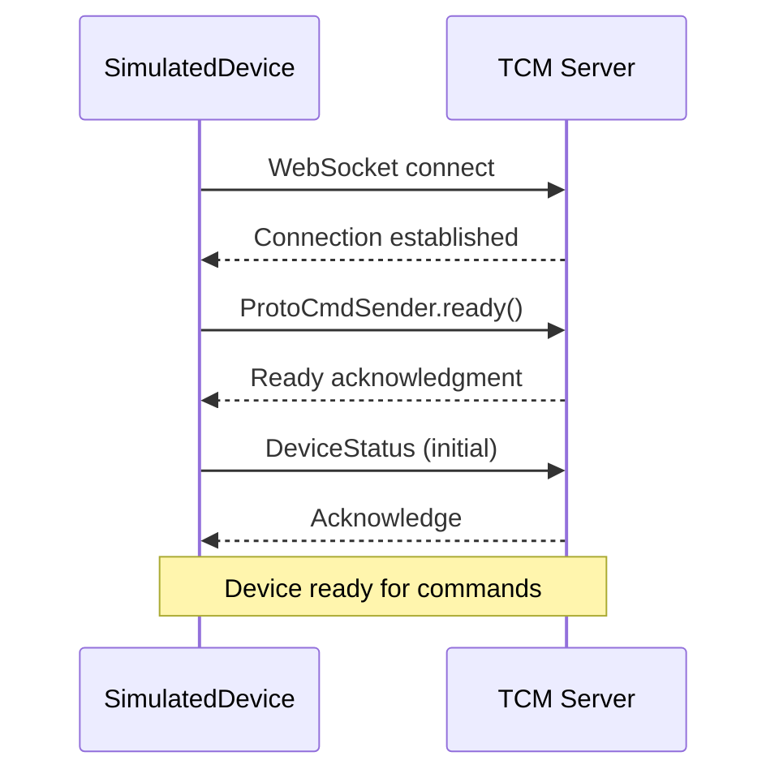
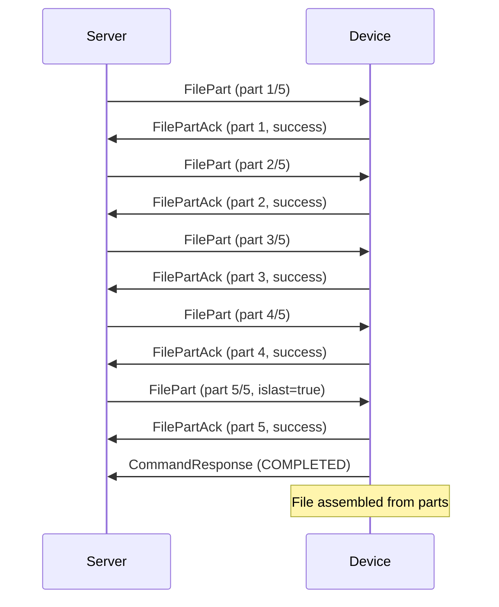
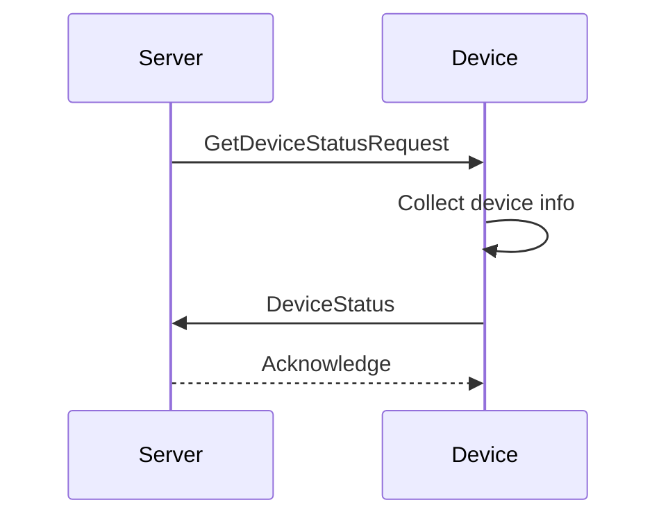
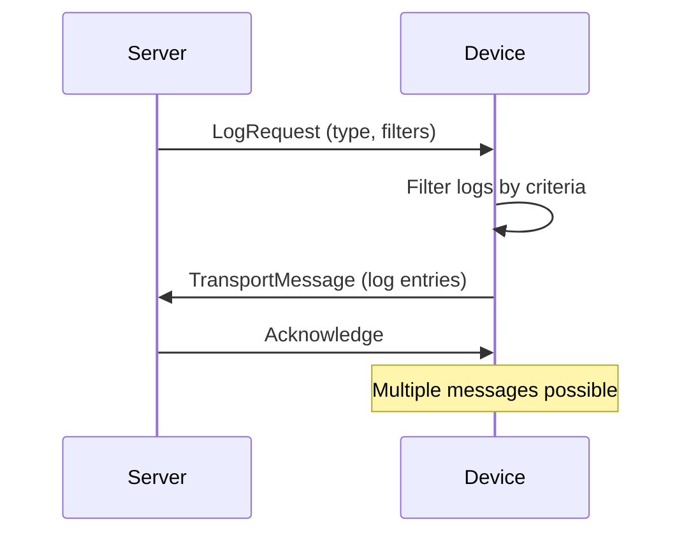
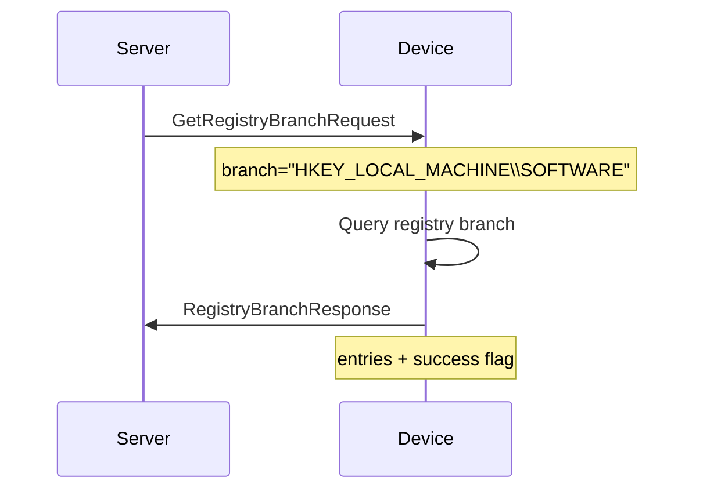
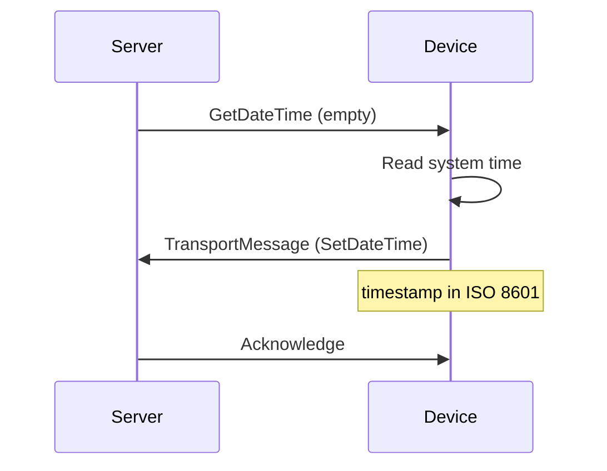
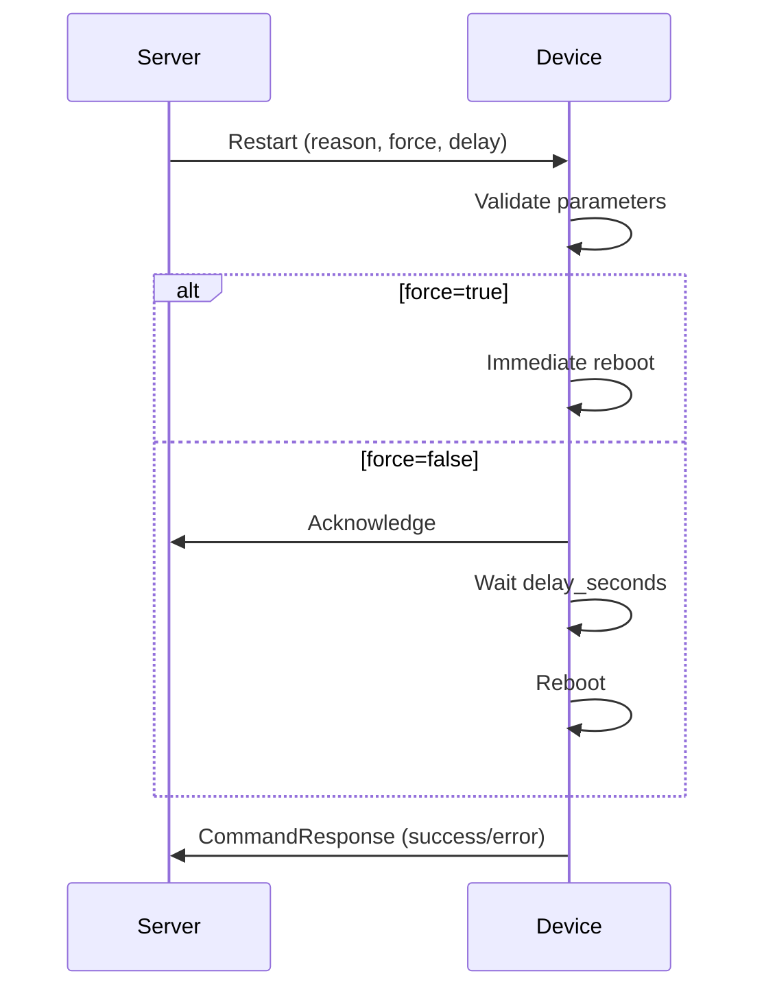

# Симулятор устройств

Симулятор для тестирования подключения множества устройств к серверу TCM.

## 📋 Возможности

- ✅ Симуляция до 1000+ устройств
- ✅ **Фиксированный пул из 1000 UID** в файле `uid-pool.json`
- ✅ Каждое устройство имеет уникальный `uid` и `device_id`
- ✅ Отправка статусов устройства (DeviceStatus)
- ✅ Приём файлов от сервера (FilePart)
- ✅ Автоматическая сборка файлов из частей
- ✅ Отправка ACK для подтверждения получения
- ✅ Переподключение при разрыве соединения
- ✅ Пакетное подключение устройств (для снижения нагрузки)
- ✅ Отдельные папки `in/` и `out/` для каждого устройства

## 🎯 Поведение устройств

При подключении каждое устройство:
1. Отправляет **DeviceStatus** серверу (однократно)
2. Готово принимать команды от сервера:
   - Запросы статуса (`GetDeviceStatusRequest`)
   - Передачу файлов (`FilePart`)
   - Запросы логов (`LogRequest`)
   - Другие команды

Устройства **не отправляют** статусы периодически — только при подключении или по запросу сервера.

## 🚀 Быстрый старт

### 1. Настройка

Отредактируйте `simulator-config.json`:

```json
{
  "deviceCount": 1000,           // Количество устройств
  "serverUrl": "ws://localhost:3005/socket",  // URL сервера
  "batchConnect": {
    "enabled": true,
    "batchSize": 50,             // Устройств в пакете
    "batchDelay": 1000           // Задержка между пакетами (мс)
  }
}
```

### 2. Запуск

```bash
# Из директории client
node simulator/run-simulator.js
```

### 3. Остановка

```
Ctrl+C
```

## 📁 Структура директорий

### Исходные файлы симулятора:

```
simulator/
├── uid-pool.json          # Пул из 1000 UID (UUID v4)
├── simulator-config.json  # Конфигурация симулятора
├── DeviceSimulator.js     # Управление множеством устройств
├── SimulatedDevice.js     # Класс одного устройства
├── run-simulator.js       # Скрипт запуска
├── simple-logger.js       # Логгер
└── devices/               # Создаётся автоматически при запуске
```

### Структура директорий устройств (создаётся автоматически):

```
simulator/devices/
├── sim-device-00001/
│   ├── in/          # Полученные файлы
│   └── out/         # Файлы для отправки
├── sim-device-00002/
│   ├── in/
│   └── out/
└── ...
```

### Как работает пул UID:

Файл `uid-pool.json` содержит массив из 1000 уникальных UUID v4:
```json
[
  "f594116b-b7a3-4591-b7ff-b1f75ca08a2a",
  "7d3d0de5-f000-4671-9e5e-5abe3c0b0ee0",
  ...
]
```

При запуске симулятор:
1. Загружает все 1000 UID из `uid-pool.json`
2. Берёт первые N UID, где N = `deviceCount` из конфигурации
3. Каждое устройство получает UID по индексу: `uid-pool[i-1]`

Пример:
- `deviceCount: 10` → используются UID[0]...UID[9]
- `deviceCount: 100` → используются UID[0]...UID[99]
- `deviceCount: 1000` → используются все UID[0]...UID[999]

## ⚙️ Конфигурация

### Параметры simulator-config.json

| Параметр | Описание | По умолчанию |
|----------|----------|--------------|
| `deviceCount` | Количество симулируемых устройств | `1000` |
| `serverUrl` | URL WebSocket сервера | `ws://localhost:3005/socket` |
| `reconnectInterval` | Интервал переподключения (мс) | `5000` |
| `workDir` | Базовая директория для устройств | `./simulator/devices` |
| `logLevel` | Уровень логирования | `info` |
| `batchConnect.enabled` | Включить пакетное подключение | `true` |
| `batchConnect.batchSize` | Размер пакета | `50` |
| `batchConnect.batchDelay` | Задержка между пакетами (мс) | `1000` |

## 🔧 Программное использование

```javascript
const DeviceSimulator = require('./simulator/DeviceSimulator');

// Создаём симулятор
const simulator = new DeviceSimulator('./simulator-config.json');

// Инициализируем устройства
await simulator._initializeDevices();

// Подключаем
await simulator.connectDevices();

// Получаем статистику
const stats = simulator.getStats();
console.log(`Connected: ${stats.connected}/${stats.totalDevices}`);

// Отправляем файл конкретному устройству
await simulator.sendFileToDevice('sim-device-00001', './test-file.txt');

// Отключаем все устройства
simulator.disconnectAll();
```

## 📊 Мониторинг

Симулятор автоматически выводит статистику каждые 30 секунд:

```
📊 === SIMULATOR STATS ===
   Total devices: 1000
   Connected: 998
   Disconnected: 2
   Work directory: ./simulator/devices
===========================
```

## 🐛 Troubleshooting

### Проблема: Устройства не подключаются

**Решение:**
1. Проверьте, что сервер запущен на правильном порту
2. Убедитесь, что `serverUrl` в конфигурации правильный
3. Проверьте firewall

### Проблема: Большая нагрузка на систему

**Решение:**
1. Уменьшите `deviceCount`
2. Увеличьте `batchSize` и `batchDelay`
3. Уменьшите количество одновременных подключений

### Проблема: Файлы не получаются

**Решение:**
1. Проверьте права на запись в `simulator/devices/*/in/`
2. Смотрите логи устройства для ошибок

## 📝 Логирование

Логи пишутся в стандартный логгер проекта. Для фильтрации логов симулятора:

```bash
# grep по симулятору
grep "simulator" logs/*.log
```

## 🧪 Тестирование

### Тест с 10 устройствами

```json
{
  "deviceCount": 10,
  "batchConnect": {
    "batchSize": 5,
    "batchDelay": 500
  }
}
```

### Тест с 1000 устройствами

```json
{
  "deviceCount": 1000,
  "batchConnect": {
    "batchSize": 100,
    "batchDelay": 2000
  }
}
```

### Стресс-тест (5000 устройств)

```json
{
  "deviceCount": 5000,
  "batchConnect": {
    "batchSize": 200,
    "batchDelay": 3000
  }
}
```

## 📡 Протокол обмена

Протокол описан в [message.proto](http://dev-abs.ru/proto). Сообщения сериализуются через **Protocol Buffers** и передаются по **WebSocket**.

### Транспортный уровень

Все сообщения передаются в обёртке **TransportMessage**:

| Поле | Тип | Описание |
|------|-----|----------|
| `uid` | string | Уникальный UUID сообщения (128-bit) |
| `sessionid` | string | Идентификатор сессии |
| `deviceid` | string | ID устройства |
| `cmdid` | uint32 | Идентификатор команды |
| `timestamp` | int64 | Unix time, ms |
| `payload` | Payload | Полезная нагрузка (oneof) |
| `requestid` | uint32 | ID запроса |
| `responseto` | uint32 | Ссылка на request_id исходного запроса |
| `crc` | uint32 | CRC32 от сериализованного payload |
| `success` | string | Флаг успеха |
| `error` | string | Сообщение об ошибке |

### Типы сообщений (Payload)

#### DeviceStatus
Информация о состоянии устройств. Содержит массив `DeviceInfo`:

| Поле | Тип | Описание |
|------|-----|----------|
| `devices` | repeated DeviceInfo | Список устройств |

**DeviceInfo** — одно устройство:

| Поле | Тип | Описание |
|------|-----|----------|
| `id` | string | Уникальный ID |
| `status` | string | online / offline / maintenance |
| `version` | string | Версия ПО |
| `model` | string | Модель |
| `temperature` | string | Температура (°C) |
| `battery` | string | Заряд батареи (%) |
| `firmware` | string | Версия firmware |

#### FilePart
Часть передаваемого файла (для больших файлов):

| Поле | Тип | Описание |
|------|-----|----------|
| `filename` | string | Имя файла |
| `partnumber` | uint32 | Номер части (с 1) |
| `totalparts` | uint32 | Общее количество частей |
| `data` | bytes | Байты данных |
| `hash` | string | Хеш части (hex) |
| `hashalgorithm` | HashAlgorithm | Алгоритм хеширования |
| `islast` | bool | Последняя часть |
| `blocksize` | uint32 | Размер блока |

#### FilePartAck
Подтверждение получения части файла:

| Поле | Тип | Описание |
|------|-----|----------|
| `partnumber` | int32 | Номер подтверждённой части |
| `success` | bool | Успешно ли принята |
| `message` | string | Сообщение об ошибке/предупреждении |

#### DeviceEvent
Событие подключения/отключения устройства:

| Поле | Тип | Описание |
|------|-----|----------|
| `eventtype` | EventType | CONNECTED / DISCONNECTED |
| `device` | string | DeviceID |
| `name` | string | Понятное имя |
| `description` | string | Описание |
| `type` | string | Тип: storage, phone, printer |
| `timestamp` | string | ISO 8601 |

#### LogRequest
Запрос логов с устройства:

| Поле | Тип | Описание |
|------|-----|----------|
| `log_type` | LogType | Системный, событий, доступ, debug и т.д. |
| `start_date` | Timestamp | Начало диапазона |
| `end_date` | Timestamp | Конец диапазона |
| `component` | string | Фильтр: auth, db, api |
| `level` | string | INFO, ERROR, DEBUG |

#### Registry (GetRegistry, GetRegistryBranch, GetRegistryValue)

| Сообщение | Описание |
|-----------|----------|
| `GetRegistryRequest` | Запрос всего реестра (пустое сообщение) |
| `RegistryResponse` | Ответ: список Entry с ключами и значениями |
| `GetRegistryBranchRequest` | Запрос ветки реестра |
| `RegistryBranchResponse` | Ответ: ветка + список записей |
| `GetRegistryValueRequest` | Запрос одного значения по ключу |
| `RegistryValueResponse` | Ответ: одно значение |

**RegistryEntry:**

| Поле | Тип | Описание |
|------|-----|----------|
| `key` | string | Полный путь |
| `value` | string | Значение |
| `type` | string | string / int / bool / json |
| `description` | string | Описание |
| `readonly` | bool | Только для чтения |

#### GetDateTime / SetDateTime
Синхронизация времени:

| Сообщение | Описание |
|-----------|----------|
| `GetDateTime` | Запрос времени с устройства (пустое) |
| `SetDateTime` | Установка времени (ISO 8601 timestamp) |

#### Restart
Команда перезагрузки устройства:

| Поле | Тип | Описание |
|------|-----|----------|
| `reason` | string | Причина: update, maintenance, manual |
| `force` | bool | Принудительная перезагрузка |
| `delay_seconds` | int32 | Задержка (0 = немедленно) |

### Enum-типы

**EventType:** UNKNOWN(0), CONNECTED(1), DISCONNECTED(2)

**HashAlgorithm:** UNSPECIFIED(0), SHA256(1), SHA512(2), SHA512RSA(3), SHA256RSA(4)

**LogType:** UNKNOWN(0), SYSTEM_LOG(1), EVENT_LOG(2), ACCESS_LOG(3), DEBUG_LOG(4), APPLICATION_LOG(5), XFS_LOG(6), TERMINAL_LOG(7)

### Сервисы (gRPC методы)

| Метод | Request | Response | Описание |
|-------|---------|----------|----------|
| `GetDateTime` | GetTimeRequest | TransportMessage | Запрос времени с устройства |
| `SetDateTime` | SetTimeRequest | TransportMessage | Установка времени |
| `GetDeviceStatus` | GetDeviceStatusRequest | TransportMessage | Запрос статуса устройств |
| `GetRegistry` | GetRegistryRequest | TransportMessage | Полный реестр |
| `GetRegistryBranch` | GetRegistryBranchRequest | TransportMessage | Ветка реестра |
| `GetRegistryValue` | GetRegistryValueRequest | TransportMessage | Одно значение реестра |
| `FilePartStream` | FilePart stream | FilePartAck stream | Стрим передачи файлов |
| `LogRequest` | FilePart stream | TransportMessage stream | Запрос логов |
| `DeviceEventStream` | GetDeviceStatusRequest | TransportMessage stream | Стрим событий |
| `RestartDevice` | Restart | TransportMessage | Перезагрузка устройства |

### Примеры сообщений

#### TransportMessage (обёртка)
```json
{
  "uid": "730797f2-c2f9-463b-9801-3e28de631f40",
  "timestamp": "1775496983713",
  "payload": {
    "DeviceStatus": { ... }
  },
  "requestid": 1,
  "crc": 1346220508
}
```

#### DeviceStatus
```json
{
  "DeviceStatus": {
    "devices": [
      {
        "id": "sensor-001",
        "status": "online",
        "model": "TS-200",
        "version": "2.1.0",
        "temperature": "45°C",
        "battery": "85%",
        "firmware": "1.0.3"
      }
    ]
  }
}
```

#### FilePart
```json
{
  "FilePart": {
    "filename": "config.txt",
    "partnumber": 1,
    "totalparts": 3,
    "data": "SGVsbG8gV29ybGQ=",
    "hash": "a1b2c3d4e5f6",
    "hashalgorithm": "SHA256",
    "islast": false,
    "blocksize": 1024
  }
}
```

#### FilePartAck
```json
{
  "FilePartAck": {
    "partnumber": 1,
    "success": true,
    "message": ""
  }
}
```

#### DeviceEvent
```json
{
  "DeviceEvent": {
    "eventtype": "CONNECTED",
    "device": "USB\\\\VID_046D&PID_C52B",
    "name": "Logitech Mouse",
    "description": "USB pointing device",
    "type": "storage",
    "timestamp": "2026-04-06T18:03:13.576Z"
  }
}
```

#### LogRequest
```json
{
  "LogRequest": {
    "log_type": "SYSTEM_LOG",
    "start_date": "2026-04-06T00:00:00Z",
    "end_date": "2026-04-06T23:59:59Z",
    "component": "auth",
    "level": "ERROR"
  }
}
```

#### RegistryResponse
```json
{
  "RegistryResponse": {
    "entries": [
      {
        "key": "device/name",
        "value": "monitoring-device-01",
        "type": "string",
        "description": "Имя устройства",
        "readonly": true
      },
      {
        "key": "network/wifi/ssid",
        "value": "Office-WiFi",
        "type": "string",
        "description": "SSID WiFi сети",
        "readonly": false
      }
    ],
    "success": true,
    "message": ""
  }
}
```

#### Restart
```json
{
  "Restart": {
    "reason": "firmware_update",
    "force": false,
    "delay_seconds": 10
  }
}
```

#### GetDateTime / SetDateTime
```json
// Запрос времени (пустое сообщение)
{
  "GetDateTime": {}
}

// Ответ с установленным временем
{
  "SetDateTime": {
    "timestamp": "2026-10-09T00:31:00+03:00"
  }
}
```

### Диаграммы обмена

#### Подключение устройства



#### Передача файла от сервера к устройству



#### Запрос статуса устройства



#### Запрос логов с устройства



#### Запрос реестра



#### Синхронизация времени



#### Перезагрузка устройства



## 📄 Лицензия

Данный проект распространяется по **коммерческой лицензии**.

Полный текст лицензии доступен в файле [LICENSES/COMMERCIAL_LICENSE.md](LICENSES/COMMERCIAL_LICENSE.md).

Для получения лицензии на использование, модификацию или интеграцию напишите в Telegram: [@andreyvakur](https://t.me/andreyvakur).
